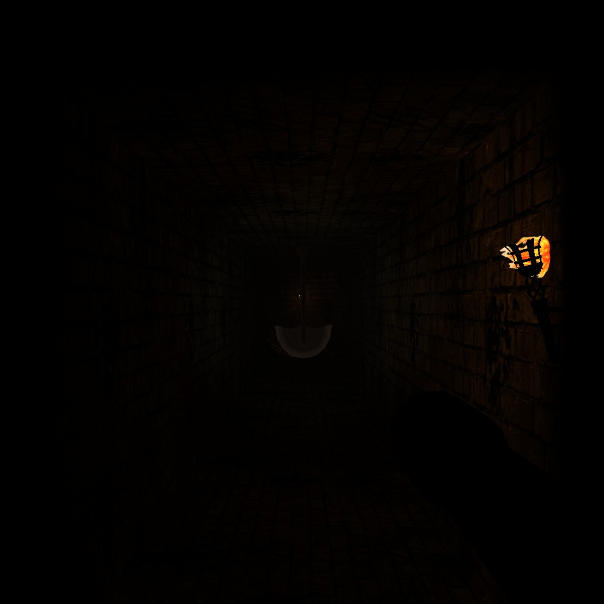
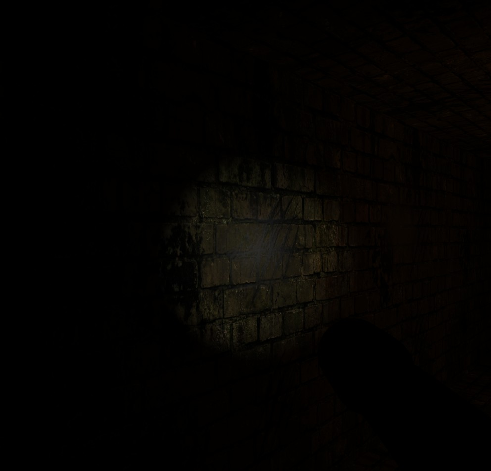
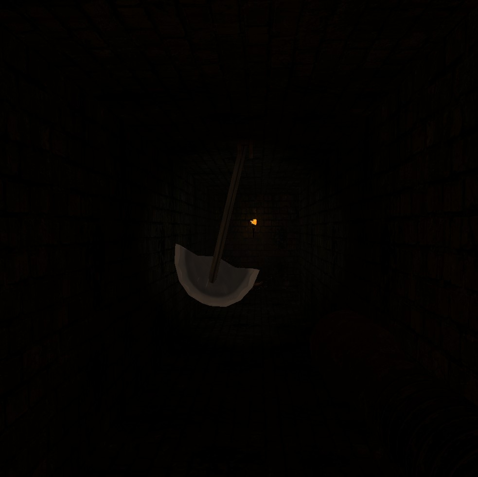
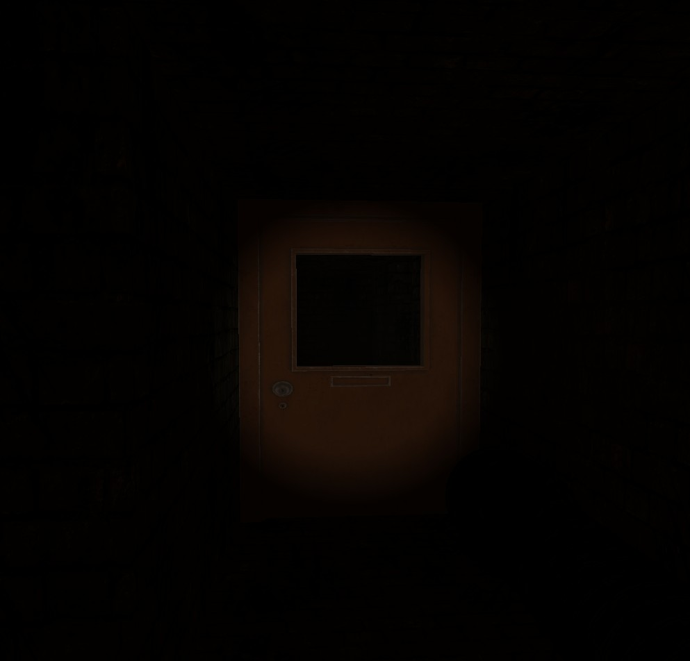
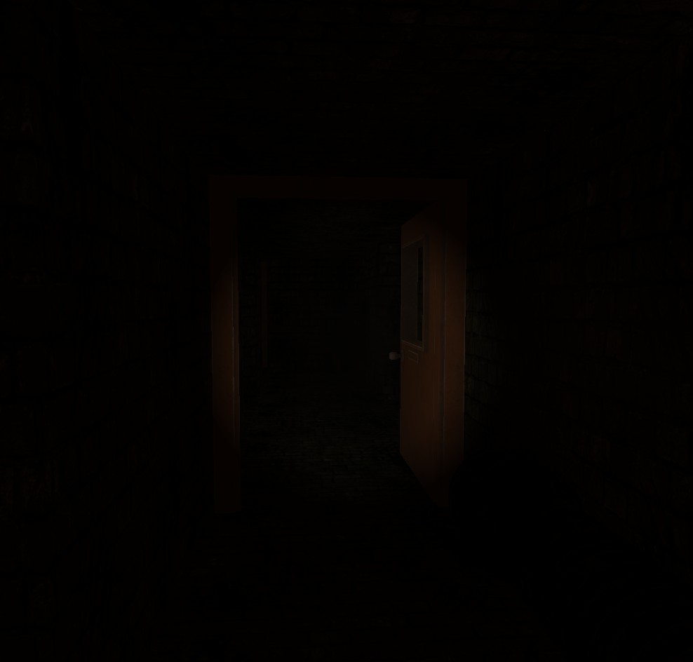
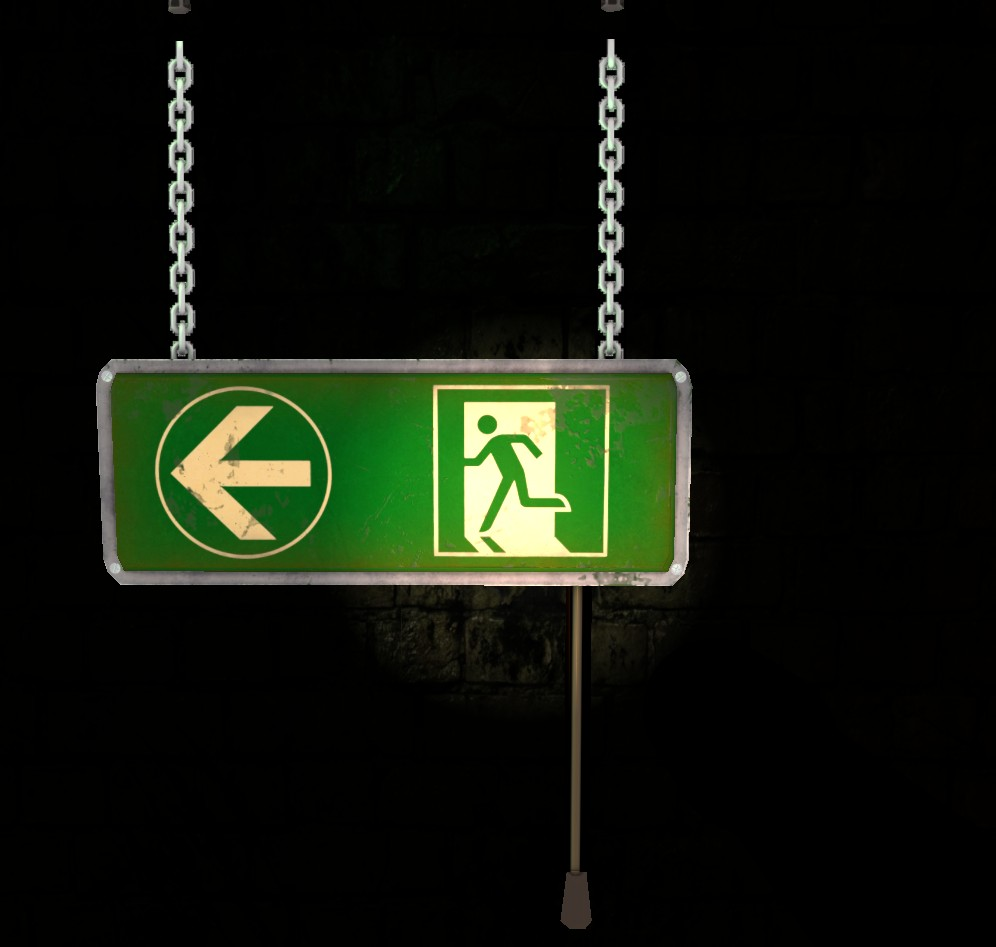
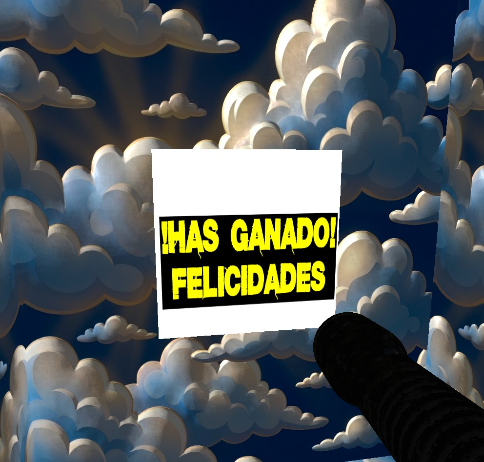

# Phobia

A first-person horror maze written in C++ on modern OpenGL (3.3 Core Profile). You are lost in a dark labyrinth with nothing but a flashlight, and you have to find the fire exit while getting past swinging pendulum blades.

Final project for the Computer Graphics course of the Computer Engineering degree at Universidad Rey Juan Carlos (2025/2026).



| Flashlight | Pendulum |
| --- | --- |
|  |  |

| Closed door | Open door |
| --- | --- |
|  |  |

| Exit sign | Escape |
| --- | --- |
|  |  |

## Features

- **Programmable pipeline only**: OpenGL 3.3 Core with VAO/VBO/EBO and custom GLSL vertex and fragment shaders, no deprecated fixed-function calls.
- **Phong lighting** (ambient + diffuse + specular) with several light types at once:
  - a dim global ambient light for the horror mood
  - a directional light
  - up to 12 point lights: wall torches with a warm, flickering fire colour and a green light under the exit sign
  - 2 spotlights attached to the camera that make up the flashlight, which can be switched off
- **First-person camera** built from Euler angles (pitch/yaw). The flashlight is rendered as a viewmodel in camera space and sways while you walk.
- **Articulated objects**:
  - Pendulums built from primitives with a `base → arm → blade` transform hierarchy. They swing (`angle = sin(t) * maxAngle`), slide along the corridor at the same time and block the player when the blade hits.
  - Doors that open with a 90° interpolated rotation when you are close enough (`CLOSED → OPENING → OPEN`). The glass panels use a two-pass render (back faces, then front faces) so both sides of the glass blend correctly.
- **Collisions** against walls, doors, pendulums and the exit room.
- **Audio with OpenAL**: footsteps, doors, crackling torches, background ambience and a crying baby doll behind one of the doors. Opening that door makes the lights flicker.
- **Top view** (`U`) that lights the whole maze from above to help you find your way.
- **Models and textures** loaded with Assimp and FreeImage.

## Controls

| Key | Action |
| --- | --- |
| `W` `A` `S` `D` | Move |
| Mouse | Look around |
| `E` | Open or close the nearest door |
| `F` | Toggle the flashlight |
| `U` | Toggle the top view |
| `Esc` | Quit |

A player guide in Spanish (story, tips and how each graphics requirement is met) is in [MANUAL.md](MANUAL.md).

## The maze file

The level is loaded from `binary/resources/models/map.cub`, a plain text grid where every character is one cell:

| Char | Cell |
| --- | --- |
| `1` | Wall |
| `0` | Empty floor |
| `N` | Player start |
| `D` | Door |
| `E` | Fire exit door (with exit sign) |
| `L` | Exit room |
| `P` | Pendulum |
| `T` | Wall torch |
| `B` | Baby doll (sound source) |

```
1111111111111111
1T0000P00010T00EL
1011111P10101111
101T00101P100001
1P10101010111101
1010111010D0T101
101B0D0000100101
1T10111010100T01
1N10001T00100001
1111111111111111
```

## Building

Requirements: CMake 3.22+ and a C++14 compiler. The Windows headers, import libraries and DLLs for GLEW, GLFW, GLM, Assimp, FreeImage and OpenAL Soft are bundled in `libraries/`. The project was developed with MinGW (the bundled OpenAL import library is the 32-bit MinGW one).

```bash
mkdir build && cd build
cmake -G "MinGW Makefiles" ..   # or: cmake -G Ninja ..
cmake --build .
```

On Linux, install the libraries from your package manager first (Debian/Ubuntu shown):

```bash
sudo apt-get install libglew-dev libglfw3-dev libglm-dev libassimp-dev libfreeimage-dev libopenal-dev
mkdir build && cd build
cmake .. && make -j"$(nproc)"
```

The executable is written to `binary/`, next to the `resources/` folder. Run it from that directory so it can find its assets:

```bash
cd binary
./phobia
```

## Project structure

```
src/
├── main.cpp, Game.*          # Window, OpenGL context and main loop
├── Scene.*                   # Map loading, lights, collisions and rendering
├── Camera.*                  # First-person camera
├── Shaders.*, Model.*, Texture.*, ResourceManager.*
├── InputManager.*            # Keyboard and mouse
├── AudioManager.*            # OpenAL sources and buffers
└── DoorManager.*, PendulumManager.*, TorchManager.*,
    ExitRoomManager.*, ExitSignManager.*, SpiderwebManager.*
binary/resources/             # Map, models, GLSL shaders, textures and sounds
libraries/                    # Bundled third-party libraries
```

## Authors

- Sergio Barrios Paz ([@CodeInIA](https://github.com/CodeInIA))
- Jorge Sánchez Aguilar ([@josanchdev](https://github.com/josanchdev))

## License

Academic project for the Computer Graphics course, 2025/2026. Third-party libraries keep their own licenses. Textures are our own or royalty-free.
